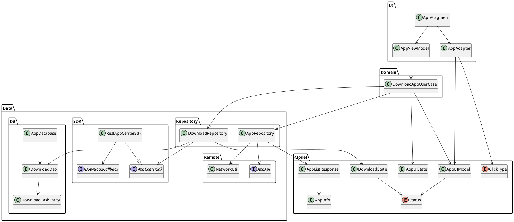
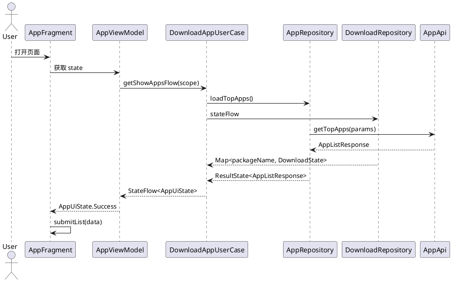
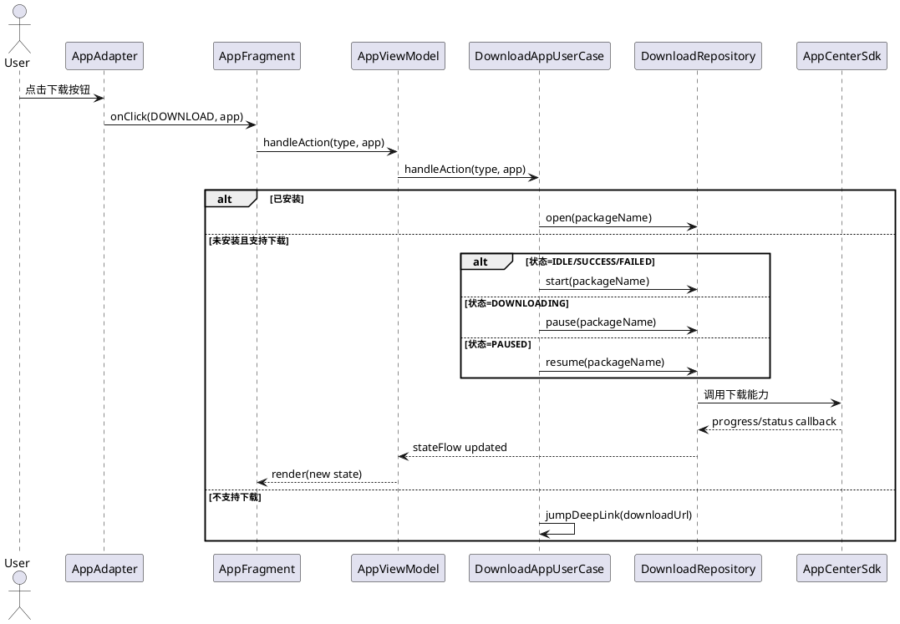
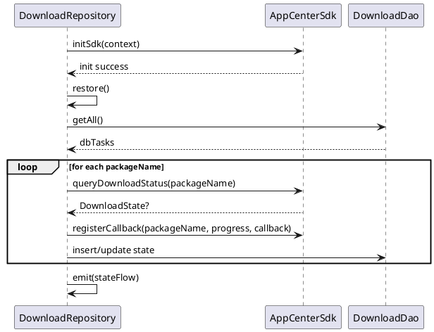
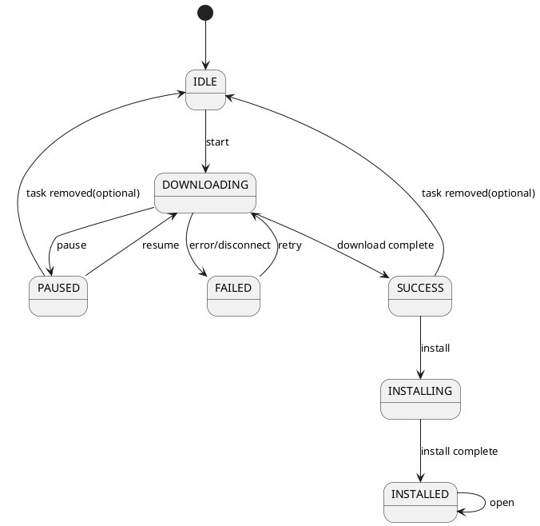

# 下载模块技术设计说明书

## 1. 文档目的

本文档用于说明下载模块的技术设计方案，覆盖模块目标、架构设计、分层职责、关键流程、数据模型、状态流转、持久化恢复机制及当前实现边界，并提供核心 UML 图，便于研发、测试和后续维护人员统一理解模块实现。

## 2. 适用范围

本文档适用于当前工程中的下载展示与下载控制模块，主要对应包路径：

```text
com.xxh.summary.download
```

## 3. 设计目标

- 提供统一的应用列表展示与下载操作能力
- 将“应用元数据”和“下载运行态”进行解耦并在业务层聚合
- 对第三方下载 SDK 做隔离封装，降低上层耦合
- 提供下载状态持久化和冷启动恢复能力
- 通过响应式状态流驱动 UI 更新

## 4. 总体设计

### 4.1 架构概览

模块采用分层设计：

- UI 层：负责页面展示、用户交互、列表刷新
- Domain 层：负责业务编排、状态聚合、行为决策
- Data 层：负责网络数据、下载 SDK 接入、数据库存储
- DI 层：负责对象创建与依赖注入

### 4.2 架构说明

应用列表数据与下载状态数据来源不同：

- 应用列表数据来源于远程接口
- 下载状态来源于下载 SDK 回调与本地数据库恢复

模块核心设计点是使用 `DownloadAppUserCase` 对两类数据进行聚合，并通过 `StateFlow<AppUiState>` 向 UI 暴露最终展示状态。

## 5. 模块结构设计

### 5.1 包结构

```text
download/
├── ui/
│   ├── AppFragment.kt
│   ├── AppViewModel.kt
│   └── adapter/AppAdapter.kt
├── domain/
│   └── DownloadAppUserCase.kt
├── data/
│   ├── repository/
│   │   ├── AppRepository.kt
│   │   └── DownloadRepository.kt
│   ├── remote/
│   │   ├── api/AppApi.kt
│   │   ├── NetworkUtil.kt
│   │   └── config/*.kt
│   ├── sdk/
│   │   ├── AppCenterSdk.kt
│   │   ├── RealAppCenterSdk.kt
│   │   └── DownloadCallback.kt
│   └── db/
│       ├── AppDatabase.kt
│       ├── DownloadDao.kt
│       └── DownloadTaskEntity.kt
├── model/
│   ├── AppInfo.kt
│   ├── AppUIModel.kt
│   ├── AppUiState.kt
│   ├── ClickType.kt
│   └── DownloadState.kt
└── di/
    ├── DataModule.kt
    └── AppSdkModule.kt
```

### 5.2 分层职责

#### UI 层

- `AppFragment`
  - 初始化列表
  - 订阅 `AppViewModel.state`
  - 渲染 `Loading/Success/Error`
  - 分发点击事件

- `AppViewModel`
  - 持有 `DownloadAppUserCase`
  - 对外暴露页面状态
  - 转发用户操作

- `AppAdapter`
  - 渲染列表项
  - 映射按钮文案
  - 基于 `DiffUtil` 做增量刷新

#### Domain 层

- `DownloadAppUserCase`
  - 合并应用列表与下载状态
  - 构造 `AppUIModel`
  - 处理条目点击和下载按钮点击
  - 屏蔽 UI 对底层下载实现的感知

#### Data 层

- `AppRepository`
  - 拉取应用列表接口
  - 对榜单结果进行简单缓存

- `DownloadRepository`
  - 持有下载状态内存缓存
  - 执行开始/暂停/恢复/打开
  - 接收 SDK 回调并更新状态
  - 状态落库和冷启动恢复

- `RealAppCenterSdk`
  - 对接应用中心下载服务
  - 状态码转换
  - 下载相关回调封装

- `Room`
  - 持久化下载进度和状态

#### DI 层

- `DataModule`
  - 提供 `AppApi`、`AppDatabase`、`DownloadDao`

- `AppSdkModule`
  - 绑定 `AppCenterSdk` 到 `RealAppCenterSdk`

## 6. 核心类设计

### 6.1 `AppFragment`

文件：[AppFragment.kt](/Users/xiongxingheng/Desktop/Develop/Samples/SampleSummary/xsummary/SummaryTest/src/main/java/com/xxh/summary/download/ui/AppFragment.kt)

职责：

- 页面初始化
- 列表适配器绑定
- 订阅 ViewModel 状态
- 根据状态刷新页面

### 6.2 `AppViewModel`

文件：[AppViewModel.kt](/Users/xiongxingheng/Desktop/Develop/Samples/SampleSummary/xsummary/SummaryTest/src/main/java/com/xxh/summary/download/ui/AppViewModel.kt)

职责：

- 从 `DownloadAppUserCase` 获取页面状态流
- 接收 UI 行为并调用 `handleAction`

### 6.3 `DownloadAppUserCase`

文件：[DownloadAppUserCase.kt](/Users/xiongxingheng/Desktop/Develop/Samples/SampleSummary/xsummary/SummaryTest/src/main/java/com/xxh/summary/download/domain/DownloadAppUserCase.kt)

职责：

- 使用 `combine` 聚合：
  - `AppRepository.loadTopApps()`
  - `DownloadRepository.stateFlow`
- 将 `AppInfo` 转换为 `AppUIModel`
- 根据点击类型和当前状态分发动作

关键业务规则：

- 若应用已安装，优先执行打开
- 若设备不支持下载，走 deeplink 跳转
- 按当前状态决定开始、暂停、继续、重试、打开

### 6.4 `AppRepository`

文件：[AppRepository.kt](/Users/xiongxingheng/Desktop/Develop/Samples/SampleSummary/xsummary/SummaryTest/src/main/java/com/xxh/summary/download/data/repository/AppRepository.kt)

职责：

- 拉取榜单、热门、最近推荐列表
- 对 `loadTopApps()` 返回结果做内存缓存

### 6.5 `DownloadRepository`

文件：[DownloadRepository.kt](/Users/xiongxingheng/Desktop/Develop/Samples/SampleSummary/xsummary/SummaryTest/src/main/java/com/xxh/summary/download/data/repository/DownloadRepository.kt)

职责：

- 管理下载状态内存态 `StateFlow<Map<String, DownloadState>>`
- 状态变更时同步更新内存与数据库
- 在模块初始化时恢复历史状态
- 注册下载回调，保持 UI 与下载状态同步

关键设计：

- 使用 `packageName` 作为下载任务唯一键
- 对下载中状态做 1 秒节流落库
- 恢复时先读 DB，再读 SDK，再补回调

### 6.6 `RealAppCenterSdk`

文件：[RealAppCenterSdk.kt](/Users/xiongxingheng/Desktop/Develop/Samples/SampleSummary/xsummary/SummaryTest/src/main/java/com/xxh/summary/download/data/sdk/RealAppCenterSdk.kt)

职责：

- 初始化应用中心服务
- 检查服务可用性与 CTA 状态
- 执行下载、暂停、恢复
- 查询远端下载状态与进度
- 接收下载回调并转换为模块内部状态

## 7. 数据模型设计

### 7.1 应用信息模型

文件：[AppInfo.kt](/Users/xiongxingheng/Desktop/Develop/Samples/SampleSummary/xsummary/SummaryTest/src/main/java/com/xxh/summary/download/model/AppInfo.kt)

```text
AppListResponse
└── dataList: List<AppInfo>

AppInfo
├── appId
├── name
├── icon
├── downloadUrl
├── packageName
├── downloadCount
├── detailUrl
├── summary
├── appSize
└── itemType
```

### 7.2 UI 展示模型

文件：[AppUIModel.kt](/Users/xiongxingheng/Desktop/Develop/Samples/SampleSummary/xsummary/SummaryTest/src/main/java/com/xxh/summary/download/model/AppUIModel.kt)

在应用基础信息之上增加：

- `progress`
- `status`

该模型是列表层的最终展示模型。

### 7.3 下载状态模型

文件：[DownloadState.kt](/Users/xiongxingheng/Desktop/Develop/Samples/SampleSummary/xsummary/SummaryTest/src/main/java/com/xxh/summary/download/model/DownloadState.kt)

字段：

- `packageName`
- `progress`
- `status`
- `error`

状态枚举：

- `IDLE`
- `DOWNLOADING`
- `PAUSED`
- `SUCCESS`
- `FAILED`
- `INSTALLING`
- `INSTALLED`
- `UNKNOWN`

### 7.4 UI 状态模型

文件：[AppUiState.kt](/Users/xiongxingheng/Desktop/Develop/Samples/SampleSummary/xsummary/SummaryTest/src/main/java/com/xxh/summary/download/model/AppUiState.kt)

- `Idle`
- `Loading`
- `Success`
- `Error`

## 8. 核心流程设计

### 8.1 页面加载流程

1. `AppFragment` 创建并初始化列表
2. `AppViewModel` 暴露 `state`
3. `DownloadAppUserCase` 组合接口流和下载状态流
4. `AppRepository` 发起榜单请求
5. `DownloadRepository` 提供当前下载状态
6. 组合结果输出为 `AppUiState`
7. `AppFragment` 渲染列表

### 8.2 下载流程

1. 用户点击下载按钮
2. `AppAdapter` 回调 `ClickType.DOWNLOAD`
3. `AppViewModel` 将事件转给 `DownloadAppUserCase`
4. `DownloadAppUserCase` 根据当前状态选择开始、暂停、恢复、打开或 deeplink
5. `DownloadRepository` 调用 `AppCenterSdk`
6. SDK 通过回调返回进度或状态变化
7. `DownloadRepository` 更新 `stateFlow` 并落库
8. UI 自动刷新

### 8.3 冷启动恢复流程

1. `DownloadRepository` 在初始化时调用 `sdk.initSdk`
2. SDK 初始化成功后触发 `restore`
3. 通过 `DownloadDao.getAll()` 读取本地历史任务
4. 针对每个任务调用 `queryDownloadStatusSync`
5. 以 SDK 返回状态覆盖 DB 状态
6. 为每个任务重新注册回调
7. 将恢复后的状态统一发射到 `stateFlow`

## 9. PlantUML 核心 UML 图

### 9.1 模块静态类图



### 9.2 页面加载时序图



### 9.3 下载操作时序图



### 9.4 冷启动恢复时序图



### 9.5 下载状态机图



## 10. 持久化设计

### 10.1 表设计

表名：`download_task`

字段说明：

- `packageName`：主键，应用包名
- `status`：下载状态枚举值索引
- `progress`：下载进度
- `updateTime`：更新时间

### 10.2 落库策略

- 每次状态更新后触发持久化
- 若状态为 `DOWNLOADING`，1 秒内重复进度不上报到 DB
- 其余状态直接落库

### 10.3 恢复策略

- 启动后读取历史任务
- 再向 SDK 查询一次远端真实状态
- 若远端有结果，以远端状态为准
- 补注册回调，保证恢复后还能持续监听

## 11. 状态与交互规则

### 11.1 下载按钮文案规则

- `IDLE`：下载
- `DOWNLOADING`：暂停
- `PAUSED`：继续
- `SUCCESS`：安装
- `INSTALLING`：安装中
- `INSTALLED`：打开
- `FAILED`：重试

### 11.2 点击行为规则

- 点击整个条目：
  - 已安装时打开应用
  - 未安装时跳详情 deeplink，并补充下载监听

- 点击下载按钮：
  - 支持下载时，按状态执行开始、暂停、恢复、重试、打开
  - 不支持下载时，跳下载 deeplink

## 12. 异常与边界处理

当前实现已覆盖以下场景：

- SDK 初始化失败时，不执行恢复
- 下载启动异常时转失败态
- 暂停、恢复异常时捕获日志，避免主流程崩溃
- 断连时根据本地状态回退为失败态

当前尚未完全覆盖的边界：

- 已安装状态判断未实现
- deeplink 跳转未实现
- 打开应用能力未实现
- UI 层未提供完整错误态、空态组件
- 历史成功任务清理逻辑未启用

## 13. 性能设计

- 使用 `StateFlow` 实现状态分发，降低主动轮询成本
- 使用 `DiffUtil payload` 做列表局部刷新
- 使用内存 Map 存储下载状态，提升按包名查询效率
- 下载中状态落库节流，避免频繁 IO
- 恢复流程以 SDK 查询结果修正 DB 状态，减少错误展示窗口

## 14. 安全与依赖说明

- 网络请求附带签名参数，签名基于参数排序后拼接密钥生成 MD5
- 环境切换由 `EnvManager` 控制
- 下载服务依赖第三方 AAR：`libs/AppStoreLib-10.2-20260427103918-release.aar`
- AndroidManifest 中声明了应用中心相关 `provider queries`

## 15. 已知问题与后续演进建议

- 补齐 `isInstalled()` 实现，接入包管理器判断
- 补齐 `jumpDeepLink()` 实现，打通详情页和下载页跳转
- 补齐 `open()` 实现，打通安装后打开应用
- 增加 `tv_status` 展示内容，如“下载中 35%”
- 增加错误态、空态、重试态页面
- 为下载恢复、状态转换和接口失败场景补测试
- 视业务需要增加缓存失效策略和手动刷新能力

## 16. 结论

当前下载模块已完成核心主链路设计，具备列表展示、下载控制、状态跟踪和冷启动恢复能力。其技术实现重点在于使用用例层聚合多源数据，并以仓库模式封装远程接口、下载 SDK 和持久化存储，整体结构清晰，适合继续扩展为可交付业务模块。
