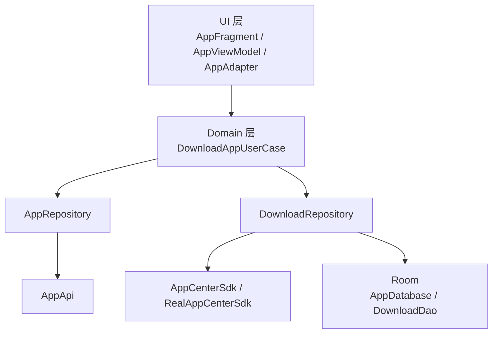
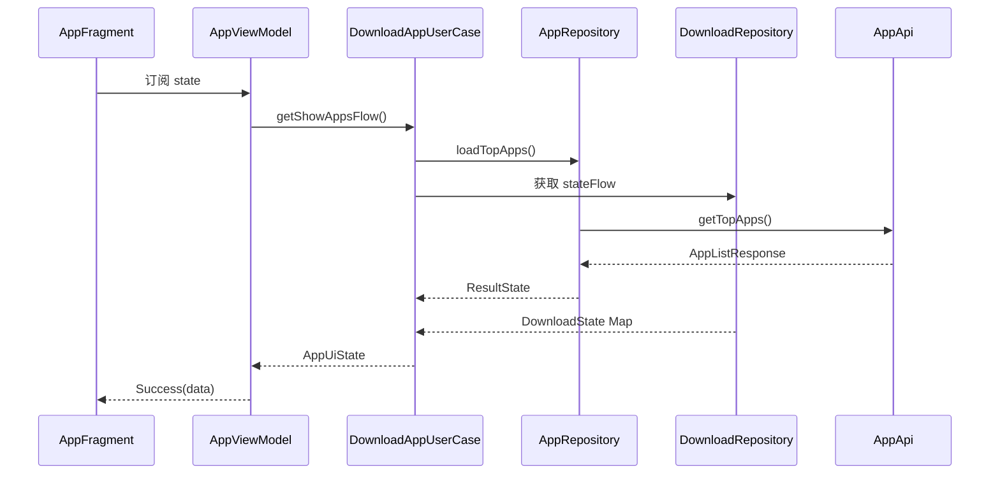
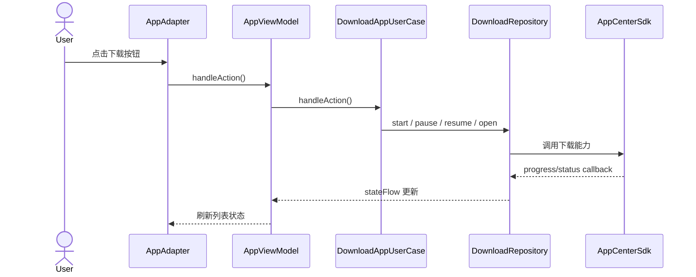
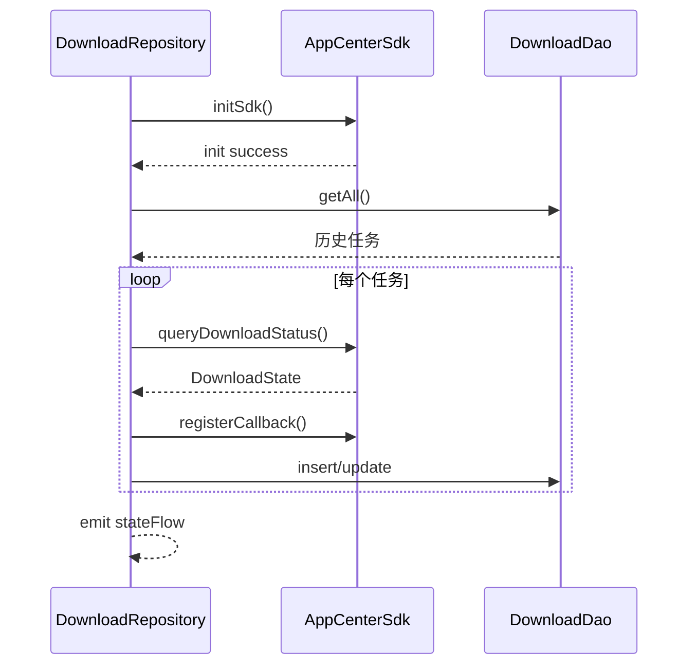
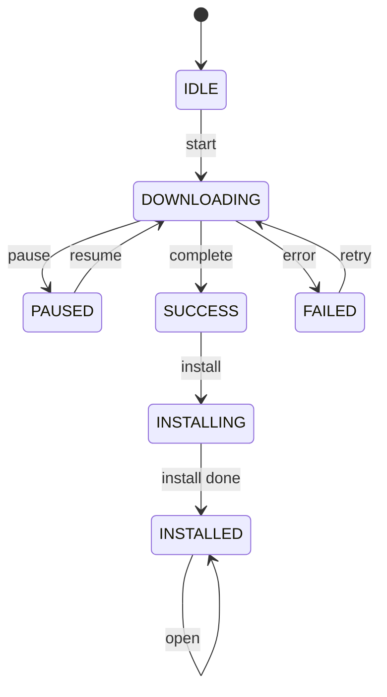

# 下载模块架构摘要版

## 1. 模块定位

下载模块用于完成应用列表展示、下载控制、状态跟踪和冷启动恢复，面向的核心场景是“展示应用并驱动下载行为”。

模块当前包含以下主要能力：

- 拉取应用榜单/推荐列表
- 展示应用基础信息和下载状态
- 执行下载、暂停、继续、重试、打开等操作
- 持久化下载状态并在冷启动后恢复

## 2. 架构摘要

模块采用分层设计，核心思路是将“应用静态信息”和“下载动态状态”解耦，再在业务层统一聚合成 UI 可直接消费的数据。

- UI 层：负责页面展示和交互分发
- Domain 层：负责业务编排和状态聚合
- Data 层：负责接口、下载 SDK、数据库
- DI 层：负责依赖注入

## 3. 核心结构图

## 4. 关键职责

### UI 层

- `AppFragment`：初始化页面、订阅状态、渲染列表
- `AppViewModel`：承接 UI 事件并暴露页面状态
- `AppAdapter`：渲染应用列表和下载按钮状态

### Domain 层

- `DownloadAppUserCase`：模块业务中心
- 聚合接口数据和下载状态
- 将 `AppInfo` 转换为 `AppUIModel`
- 根据点击类型和当前状态决定具体动作

### Data 层

- `AppRepository`：拉取应用列表并做简单缓存
- `DownloadRepository`：统一管理下载状态、落库和恢复
- `RealAppCenterSdk`：封装底层下载 SDK 能力
- `Room`：保存下载任务状态

## 5. 核心流程

### 5.1 页面加载流程

页面启动后，请求应用列表，同时读取当前下载状态。业务层将两路数据合并后输出给 UI，页面最终展示为带下载状态的应用列表。

### 5.2 下载操作流程

用户点击下载按钮后，业务层根据当前状态决定执行开始、暂停、继续、重试或打开。底层 SDK 回调新的进度和状态后，页面自动刷新。

### 5.3 冷启动恢复流程

模块启动时先从数据库恢复历史任务，再向 SDK 查询真实状态，并重新注册回调，确保页面状态与下载任务一致。

## 6. 核心数据模型

- `AppInfo`：接口返回的应用基础信息
- `DownloadState`：下载状态、进度、错误信息
- `AppUIModel`：列表最终展示模型
- `AppUiState`：页面状态模型

## 7. 状态流转

下载状态围绕 `Status` 枚举流转，按钮文案跟随状态变化。

按钮文案映射如下：

- `IDLE`：下载
- `DOWNLOADING`：暂停
- `PAUSED`：继续
- `SUCCESS`：安装
- `INSTALLING`：安装中
- `INSTALLED`：打开
- `FAILED`：重试

## 8. 持久化与恢复设计

- 数据表：`download_task`
- 主键：`packageName`
- 存储内容：状态、进度、更新时间
- 下载中状态按 1 秒节流落库，降低频繁写入开销
- 恢复时以 SDK 查询结果修正 DB 状态

## 9. 当前实现边界

当前主干链路已经具备，但还有几个能力待补齐：

- `isInstalled()` 尚未实现
- `jumpDeepLink()` 尚未实现
- `open()` 尚未实现
- 加载态、错误态 UI 仍较简单
- `tv_status` 尚未展示更完整的进度文案

## 10. 结论

该模块当前已经形成清晰的分层结构，核心价值在于通过业务层把接口数据和下载状态统一聚合，最终以响应式方式驱动 UI。后续重点建议放在补齐安装态判断、跳转打开能力和异常态体验上，而不是大幅调整整体架构。
